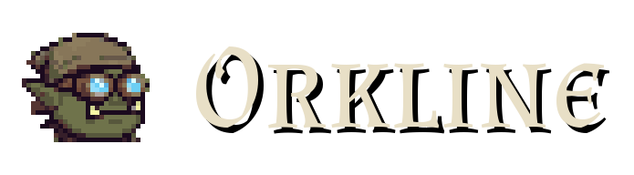
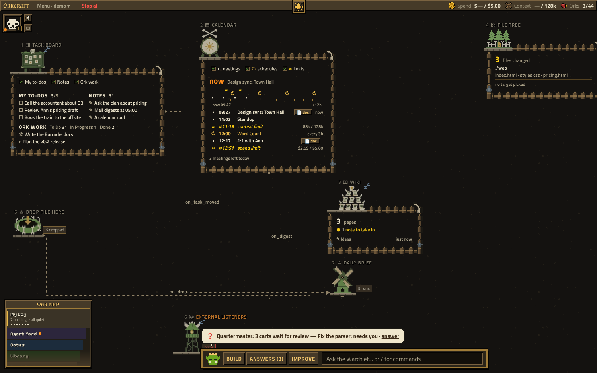
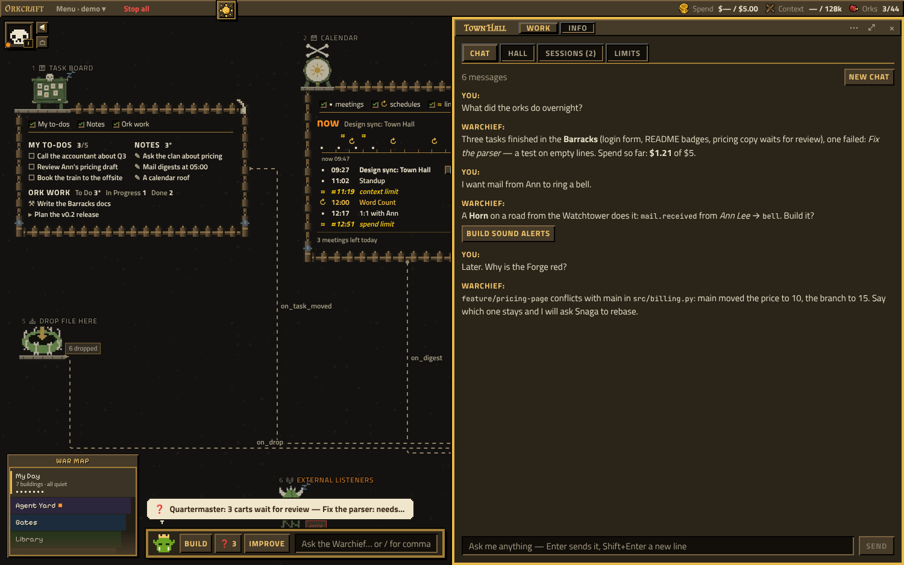
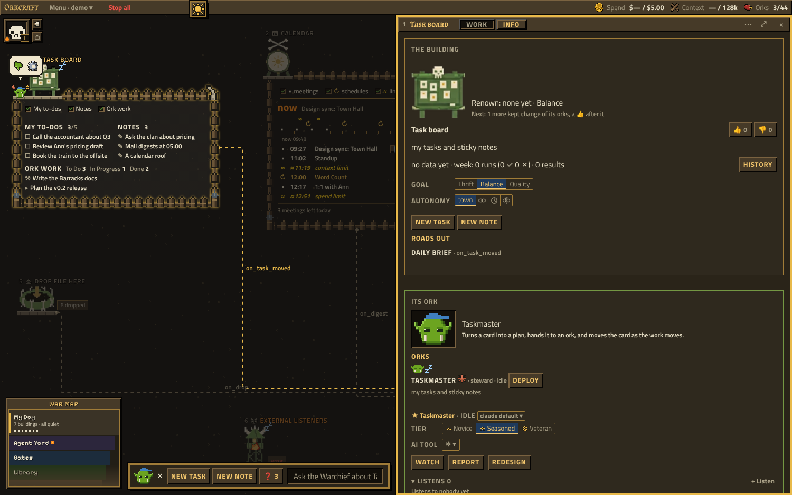

<p align="center">
  <picture>
    <source media="(prefers-color-scheme: dark)" srcset="docs/img/logo-dark.png">
    <source media="(prefers-color-scheme: light)" srcset="docs/img/logo-light.png">
    
  </picture>
</p>

<h3 align="center">Run many coding agents in one project — and see them like a real-time strategy game.</h3>

<p align="center">
  Claude Code · Codex · Antigravity — no API keys · local-first · Apache 2.0
</p>

<!-- The hero GIF goes here: a town at work, a cart on a road, a hut on fire waiting for you. -->


Running three or five agents at once gets messy fast: which one is working, which one is stuck
waiting for you, what did they change, and how much has this cost today? Terminals and tabs don't
answer that.

**Orkline opens your project as a town.** Every window is a **building** with an **ork** inside — an
agent, a script or a chain of data steps. Buildings send **carts** to each other along **roads**, so
work flows on its own. You see the whole town at a glance:

- 🔥 **An ork that needs you sets its hut on fire** and waits. No pop-ups, no lost questions — and the
  phone app shows them too.
- 🪙 **The HUD shows what you spend**, by building and purpose, with budgets that stop model calls.
- 🛤 **Roads do the orkestration.** Mail, GitHub, a calendar or a dropped file starts work; a task
  goes to the Agent pool, a branch to Branches & PRs, a result to the Review gate where you approve it.
- 🛡 **Safe by default.** The Warder hook blocks `rm -rf`, secret reads and force-pushes; Orkline
  snapshots files before an ork touches them; **Stop all** halts everything.
- 🧰 **Your tools, your login.** It talks to models only through the CLIs you already have —
  [Claude Code](https://claude.com/claude-code) (`claude`), [OpenAI Codex](https://github.com/openai/codex)
  (`codex`) and Google Antigravity (`agy`). No keys, no accounts, no servers.

> [!WARNING]
> **Alpha.** Orkline is used daily and has ~1,300 tests, but features and file formats still change
> between versions. Try it on a project you have committed or backed up, and keep the Warder on.
> Bug reports and ideas are very welcome in [Issues](https://github.com/Orkcraft/orkcraft/issues).

## Try it in a minute

```bash
brew tap orkcraft/orkcraft https://github.com/Orkcraft/orkcraft
brew install orkcraft/orkcraft/orkcraft
orkline --demo         # a sandbox town with simulated data: nothing real is touched, no model is called
```

Without Homebrew, on macOS or Linux: `curl -fsSL https://orkcraft.dev/install.sh | sh`
(it puts uv, a Python and Orkline in place and logs each step; [docs/install.md](docs/install.md)), or
`pipx install "orkcraft[gui] @ git+https://github.com/Orkcraft/orkcraft"` (Python 3.11+ and git).
The command is `orkline`; `orkcraft`, its name before the rename, works the same.

Then in a real project:

```bash
cd your-project
orkline hooks install    # the session log + the Warder guard in .claude/settings.json (reversible)
orkline                  # open the town in a window; `orkline gui --browser` opens it in a tab
```

Optional: `claude`, `codex` and/or `agy` on your `PATH` for agents (building new buildings needs
`claude`), and `gh` for GitHub events. Orkline updates itself: a critical fix installs when the town
opens, any other update is offered ([docs/updates.md](docs/updates.md)).

Worth knowing: `/` or `Ctrl+K` puts you in the Warchief's line (`/build`, `/road`, `/orkspace`,
`@a building`, or just ask) · a right click on a hut or on the bare map has its menu · **Stop all** in
the HUD stops every running agent, script and browser. Prefer a calm screen? Settings has the
**Office** look: monochrome, no sprites, same town.

## How it works

| In the game | In your project |
|---|---|
| 🏰 **Town** | one map per workflow (an **orkspace**, `F1`–`F8`, each in its own folder and biome); every building a small hut with live status lines |
| 🏗 **Building** | a window: tasks, files, git, a mailbox, a webhook, a chart… |
| 🧌 **Ork** | an agent, a script or a free chain of data steps living in a building |
| 🛤 **Road** | a subscription: what happens in one building travels as a cart to the buildings that listen |
| 🪙 / 🪵 / 🥩 | money, context tokens and running agents — with budgets you set |
| 🧌 **Warchief** | the lead agent in the line at the town's foot: builds, lays roads and answers for you |

Roads are the point. A building never needs to know who listens to it; the listener decides what to
do with each cart. **The cheapest thing that works wins:** a plain road, then a **chain** (data steps,
no model), then a **script**, and only then an **agent**.

## The buildings

Each building has its own events and settings — and when the catalog lacks one, the **Builder**
writes a new one for you (a script first, a model only where a script can't do the job).

| | |
|---|---|
| **Intake and routing** | Drop file here (files and links) · External listeners (mail and Gmail, GitHub, Slack, Jira, Confluence, Figma, schedules, webhooks — filtered by your intent) · Router (if / switch) · Transformer (data steps, an agent where a script can't) · Sound alerts |
| **Queues and work** | Task board (tasks and sticky notes) · Agent pool (agents in parallel, a branch per task, a pull request for code) · Review board (the clan reviews a document from every side) · Calendar (agents prepare for your meetings) |
| **Knowledge and code** | File tree · Wiki (kept by its ork from your notes, code, git and Confluence) · Research (every AI tool searches alone, findings checked against each other) · Audio briefing (a report spoken as a short episode) · Inspector (diffs and Markdown, edit in place) · Branches & PRs (tests a branch in a throw-away worktree, merges) |
| **Results and output** | Review gate (carts pass by rules or wait for you) · Metrics (spend, tokens, load) · Publisher (sends over HTTP or your AI tools' MCP servers — or fills a form in a browser where there is no API) |
| **Improve** | Test bench (runs a building's cases beside the bare AI tool and says what to change) · UX bench (looks at a building's window) |

## The Town Hall

The 🏰 Town Hall is where the town changes. Everything goes through it, and everything it does is a
commit in the camp's own git, so it can be undone.



- **🏗 Build** — `/build` or a right click on the map: say what you need, or pick from the catalog.
- **🛠 New** — the **Builder** asks what the building should do and writes it. The blueprint is
  reviewed by the Council (budget, schemas, the screen, shell safety, housekeeping) and run on mock
  carts in a sandbox before you approve it.
- **🛤 Roads with a prompt** — say in words what to do with each cart; a chain or a script is made
  unless the rule really needs judgement.
- **👍 / 👎 and what you do** teach the orks: a 👎 asks whether the *inputs* were broken or the ork's
  own *logic* was wrong; a result accepted, edited, sent back, merged or never opened counts too.
- **Retros, never automatic.** A daily Building retro proposes one change where it matters most; a
  weekly Town retro audits the whole camp. Nothing applies without your click.

## Growth

Buildings and their operator grow from what the orks learned — never from clicks
([docs/design/growth.md](docs/design/growth.md)). A building earns **Renown I–III** and shows it as a
flag on its roof; your mascot grows from a Standup Zombie to a Release Night King and collects
**deeds**; the Warchief says what grew and wears the crown. The **War Map** shows your orkspaces as
lands, and calls you with rings when an ork in another one asks — as a strategy game does when your
units are attacked.



## Safety

- **Your CLIs, your login.** Models are called as `claude -p …` / `codex exec …` / `agy --print …`.
  Orkline has no API keys, accounts or servers, and sends nothing anywhere on its own. A building
  talks to the network only if you configure it to.
- **🛡 Warder** is a Claude Code and Codex `PreToolUse` hook (`orkline hooks install`): it denies
  catastrophic or secret-leaking calls (`rm -rf /`, `curl … | sh`, reading `.env` / `.ssh`,
  force-push…) and asks about destructive ones (Codex cannot ask yet, so there it denies and says
  why). `agy` has no such hook yet.
- **Snapshots.** Before and after an ork works in a project, Orkline keeps a snapshot of its files
  without touching your branch, index or git log; a land's History takes them back.
- **Scripts** run as `python3 -I` or `bash` with no shell interpolation and a timeout; handler
  scripts run only after review and are held again if the file changes.
- **Personal notes** (Markdown with `subtype: personal` in its front matter) never reach a model.
- **Budgets** — 🪙 per session, 🪵 context — stop model calls; **Stop all** stops everything.
- **Usage stats are off until you say yes** — anonymous feature counts only, never code, prompts,
  paths or names ([docs/usage-stats.md](docs/usage-stats.md)); `DO_NOT_TRACK=1` always stops them.

Orkline runs agents on your machine. Read what a building does before you let it loose.

## How it's designed

Every feature of Orkline started as a design note: the problem, the options, what was decided and
why, and an *As built* section once it shipped. A few worth reading:

- [Roads and orks](docs/design/roads-and-orcs.md) — the core model: buildings, carts, and why the
  cheapest step that works wins.
- [Calm town](docs/design/calm-town.md) — why the terminal UI was removed and the window became the one face.
- [Agent pool flows](docs/design/barracks-flows.md) — how the kind of work decides an agent's path and its review.
- [Guarding agy](docs/design/agy-guard.md) — a safety hook written from a spec, and what is still unverified.
- [Growth](docs/design/growth.md) — progression that rewards what the orks learned, not clicks.

The rest is in [docs/design/](docs/design/); the full reference — every key, building, file format
and flow — is in [docs/reference.md](docs/reference.md), and what comes next is in
[docs/roadmap.md](docs/roadmap.md).

## Where things live

Inside the project it runs in, Orkline keeps only local state (add these to your `.gitignore`):

- `.orkcraft.json` — the Town file: maps, buildings, roads, garrisons, budgets
- `.orkcraft/` — logs, sessions, per-building state and **the camp's own git** (branch `camp`) that
  tracks building specs, scripts and blueprints. It is separate from your project's history.

Environment variables are `ORKCRAFT_*` (`ORKCRAFT_CLAUDE_BIN`, `ORKCRAFT_AGY_BIN`,
`ORKCRAFT_CODEX_BIN`, `ORKCRAFT_LIMITS=0`, `ORKCRAFT_COUNCIL_LLM=0`…). You, your role, mascot and
deeds are per machine in `~/.config/orkcraft/settings.json`.

## Contributing

Orkline is young and built in the open — ideas, bug reports and pull requests are welcome.
The quickest way to help is to try `orkline --demo` or a real project and
[open an issue](https://github.com/Orkcraft/orkcraft/issues) with what confused you or broke.
Before writing code, read [CLAUDE.md](CLAUDE.md): it has the wording rules (ork, orkestration) and
where code goes.

```bash
git clone https://github.com/Orkcraft/orkcraft && cd orkcraft
python3 -m venv .venv && .venv/bin/pip install -e ".[dev]"
.venv/bin/pytest -q -n auto        # the tests in parallel; the GUI's are driven in Chromium
.venv/bin/orkline --demo
```

Every pull request and every push to `main` runs the tests on GitHub Actions.

```
orkcraft/
  cli.py             the command line
  core/              the town without a face: state, services, the bus
  gui/               the GUI face: host and server over the core, the page (Preact, no build step)
  realm/             the logic: catalog, roads, chains, council, workshop, feedback, retros…
  design/            tokens and the building UI contracts → design-system/ (CSS, fonts, sprites)
  quota/             each AI tool's quota readers (no quota spent)
  sources/ hooks/    sessions, telemetry, limits; the Claude Code and Codex hooks
  demo/              the showcase sandbox
  tools/             sprites drawn from code, the gallery and landing captures
```

## Author

Orkline is made by **Vadim Sidoryk** ([@VadimSidoryk](https://github.com/VadimSidoryk)) — first
as a tool for running the author's own agents, now for everyone who runs more than one. Much of its
code was written by coding agents under the author's direction; the decisions are in the design notes.

## License

Apache License 2.0 — see [LICENSE](LICENSE) and [NOTICE](NOTICE). Copyright 2026 Vadim Sidoryk.

The fonts bundled in `design-system/fonts/` — Almendra SC, Titillium Web, JetBrains Mono and Pixelify
Sans — are under the SIL Open Font License 1.1; their licences sit beside them.
